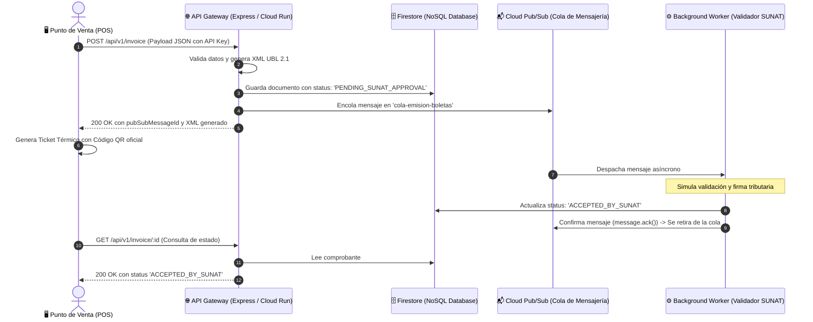

# 🎓 Guía de Sustentación del Proyecto
## SaaS de Facturación Electrónica Serverless (SUNAT UBL 2.1)

---

### 1. Resumen Ejecutivo del Proyecto
- **Curso:** Servicios Cloud / Arquitectura en la Nube
- **Objetivo:** Desarrollar una solución cloud asíncrona y serverless para la emisión y validación de boletas electrónicas bajo el estándar **UBL 2.1 de SUNAT (Perú)**.
- **Problema que resuelve:** Evitar que los sistemas de Punto de Venta (POS) en tiendas físicas se bloqueen o sufran caídas debido a la latencia o inestabilidad de los servidores de SUNAT.

---

### 2. Arquitectura del Sistema (Event-Driven Architecture)

---

### 3. Stack Tecnológico Utilizado
- **Frontend POS:** HTML5, Tailwind CSS, JavaScript Vanilla (Monitoreo asíncrono, ticket 80mm y QR SUNAT).
- **Backend API:** Node.js, Express.js (CORS habilitado, endpoints POST y GET).
- **Mensajería Asíncrona:** Google Cloud Pub/Sub (Tópico: `cola-emision-boletas`, Suscripción: `cola-emision-boletas-sub`).
- **Base de Datos NoSQL:** Google Cloud Firestore (Colección: `invoices`).
- **Procesador de Fondo (Worker):** Worker Daemon con StreamingPull de Pub/Sub.
- **Infraestructura como Código (IaC):** Scripts `setup-gcp.ps1`, `setup-gcp.sh` y `Dockerfile` (Google Cloud Run).

---

### 4. Pasos para la Demostración en Vivo ante el Jurado

1. **Venta en el POS:**
   - Abre `frontend-pos/index.html` en el navegador.
   - Ingresa un DNI y un Nombre de cliente.
   - Haz clic en **"Emitir Boleta de Venta a la Nube"**.
   - Muestra cómo de inmediato se genera el Ticket Térmico de 80mm con su Código QR oficial y el estado pasa a **PENDIENTE**.

2. **Evidencia en Google Cloud Console:**
   - Abre la consola de GCP en la suscripción `cola-emision-boletas-sub`.
   - Muestra en la pestaña **Métricas** el pico de mensajes retenidos en cola.
   - En la pestaña **Mensajes**, haz clic en **Extraer (Pull)** para mostrar el JSON con el XML UBL 2.1 en la nube.

3. **Confirmación y Cierre de Ciclo:**
   - El worker extrae el mensaje, simula la validación tributaria y actualiza Firestore.
   - El POS detecta el cambio automáticamente y el semáforo cambia a **🟢 ACCEPTED_BY_SUNAT**.

---

### 5. Preguntas Clave del Jurado y Respuestas

- **¿Por qué usar Pub/Sub y no llamadas directas a SUNAT?**
  *Porque las llamadas HTTP directas son síncronas y bloqueantes. Si SUNAT tiene alta latencia o se cae, la caja de la tienda se congelaría. Pub/Sub desacopla temporalmente la venta y garantiza que la emisión tome menos de 200ms.*

- **¿Por qué guardar en Firestore antes de encolar en Pub/Sub?**
  *Por tolerancia a fallos. Si la conexión de red fallara al intentar publicar en la cola, el comprobante ya quedó asentado en la base de datos para posterior conciliación o auditoría.*

- **¿Por qué es una arquitectura Serverless?**
  *Porque los componentes principales (Cloud Pub/Sub y Cloud Firestore) no requieren gestión de servidores físicos y escalan por demanda. Además, el backend está contenerizado con Dockerfile listo para escalar a 0 en Google Cloud Run.*

