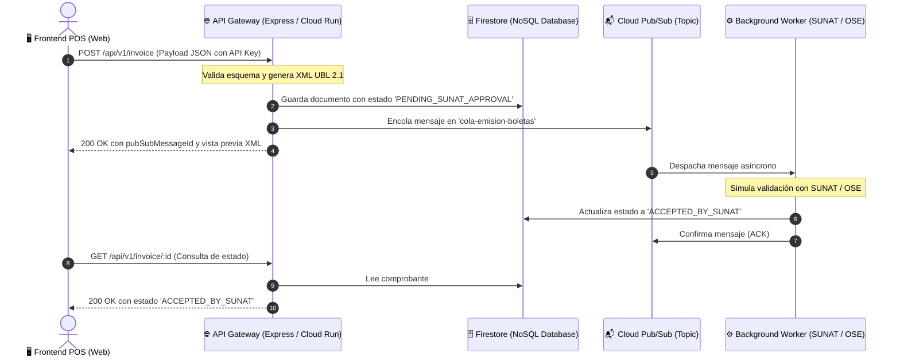

# SaaS de Facturación Electrónica (SUNAT UBL 2.1 - Perú)
> **Arquitectura en la Nube Asíncrona y Serverless con Google Cloud Platform**

Este proyecto implementa una arquitectura orientada a eventos para la emisión y validación de comprobantes de pago electrónicos bajo el estándar internacional **UBL 2.1** requerido por la **SUNAT (Perú)**.

---

## 🏛️ Arquitectura del Sistema

El flujo desacopla la recepción del comprobante del proceso de firma y validación tributaria, evitando que el punto de venta (POS) sufra retrasos o caídas de los servidores de SUNAT.



---

## 🛠️ Stack Tecnológico

| Capa / Componente | Tecnología | Rol en la Arquitectura |
| :--- | :--- | :--- |
| **Frontend POS** | HTML5, Tailwind CSS, JavaScript | Simulador de caja/punto de venta con monitor en tiempo real. |
| **API Ingestion** | Node.js, Express.js | Receptor HTTP de facturas y generador de XML UBL 2.1. |
| **Base de Datos** | Google Cloud Firestore | Persistencia NoSQL para estados y documentos de factura. |
| **Cola de Mensajería** | Google Cloud Pub/Sub | Desacoplamiento asíncrono con tópico y suscripción. |
| **Worker / Procesador** | Node.js Worker Daemon | Consumidor de eventos y validador con SUNAT. |
| **Infraestructura** | Scripts gcloud & Docker | IaC y contenedorización para Cloud Run. |

---

## 📂 Estructura del Repositorio

```text
saas-facturacion-serverless/
├── backend-functions/           # Código del API y del Worker
│   ├── src/
│   │   ├── app.js               # Servidor Express (Endpoints POST y GET)
│   │   ├── worker.js            # Consumidor de Pub/Sub
│   │   ├── schemas/
│   │   │   └── ublSchema.js     # Estructura del estándar UBL 2.1
│   │   └── utils/
│   │       ├── firebase.js      # Conexión con Cloud Firestore
│   │       ├── pubsub.js        # Publicador de mensajes a Pub/Sub
│   │       └── xmlBuilder.js    # Constructor de XML (xml2js)
│   ├── package.json
│   └── serviceAccountKey.json   # Credenciales GCP (Protegido por .gitignore)
├── frontend-pos/                # Interfaz Gráfica del Punto de Venta
│   └── index.html               # Simulador de POS y monitor en tiempo real
├── infrastructure/              # Scripts de despliegue en la nube
│   ├── Dockerfile               # Imagen de contenedor para Cloud Run
│   ├── setup-gcp.ps1            # Script de aprovisionamiento en PowerShell
│   └── setup-gcp.sh             # Script de aprovisionamiento en Bash
└── README.md
```

---

## 🚀 Guía de Ejecución Rápida

### 1. Requisitos Previos
- Node.js v18+ instalado.
- Cuenta de Google Cloud con Pub/Sub y Firestore habilitados.
- Archivo `serviceAccountKey.json` ubicado dentro de `backend-functions/`.

### 2. Iniciar el Backend API
Abre una terminal en la carpeta `backend-functions`:
```bash
cd backend-functions
npm install
node src/app.js
```
*El servidor iniciará en: `http://localhost:3000`*

### 3. Iniciar el Worker de Procesamiento
Abre una **segunda terminal** en la carpeta `backend-functions`:
```bash
cd backend-functions
node src/worker.js
```
*El worker empezará a escuchar la suscripción `cola-emision-boletas-sub`.*

### 4. Abrir el Frontend POS
Abre el archivo `frontend-pos/index.html` en tu navegador web preferido (o con Live Server).
1. Haz clic en **"Emitir Comprobante a la Nube"**.
2. Observa cómo el monitor pasa automáticamente de **🟡 PENDING_SUNAT_APPROVAL** a **🟢 ACCEPTED_BY_SUNAT** cuando el worker lo procesa.
3. Copia o inspecciona el XML UBL 2.1 generado.

---

## 📡 Endpoints del API

### `POST /api/v1/invoice`
- **Cabeceras:** `x-api-key: mi-super-api-key-secreta-2026`, `Content-Type: application/json`
- **Descripción:** Genera el XML UBL 2.1, lo guarda en Firestore con estado pendiente y lo encola en Pub/Sub.

### `GET /api/v1/invoice/:id`
- **Cabeceras:** `x-api-key: mi-super-api-key-secreta-2026`
- **Descripción:** Consulta el estado actual de la factura en Firestore (`PENDING_SUNAT_APPROVAL` o `ACCEPTED_BY_SUNAT`).

### `GET /api/v1/health`
- **Descripción:** Comprueba que el servidor backend esté en línea.
