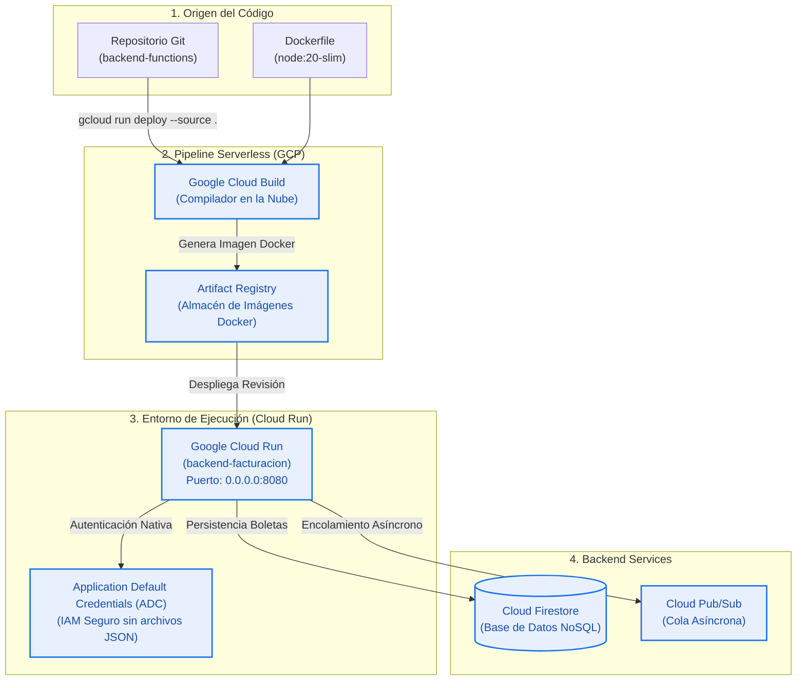

# 🚀 Guía de Sustentación: Despliegue en Google Cloud Platform (Cloud Run)
**Curso:** Servicios Cloud / Arquitecturas en la Nube  
**Proyecto:** SaaS Facturación Electrónica SUNAT UBL 2.1 Serverless  
**Autor:** Equipo de Desarrollo  

---

## 🎯 1. El Pitch de Entrada (30 Segundos para Iniciar)

> *"Profesor, buenas noches. Para nuestro sistema de facturación electrónica UBL 2.1, hemos implementado una estrategia de despliegue **100% Serverless basada en Contenedores** utilizando **Google Cloud Run**.  
> Nuestro backend no depende de servidores virtuales encendidos 24/7 que desperdicien presupuesto. En su lugar, el código se compila automáticamente en la nube con **Cloud Build**, se aloja como imagen inmutable en **Artifact Registry**, y se ejecuta sobre **Cloud Run**, logrando escalabilidad elástica y **Scale-to-Zero** (costo $0.00 cuando nadie está emitiendo comprobantes)."*

---

## 🏗️ 2. Arquitectura Visual del Despliegue

---

## 🧠 3. Conceptos Clave Explicados de Forma Sencilla

Si el profesor pregunta qué hace cada pieza del despliegue, respóndele con estas analogías:

| Componente | ¿Qué es de forma simple? | ¿Para qué sirve en nuestro proyecto? |
| :--- | :--- | :--- |
| **`Dockerfile` (`node:20-slim`)** | La "receta de cocina" que empaqueta nuestra app. | Garantiza que la app corra exactamente igual en cualquier máquina del mundo, sin depender del sistema operativo. |
| **`Cloud Build`** | Nuestro "obrero digital" en la nube. | Lee el Dockerfile, descarga los paquetes de Node (`npm install --omit=dev`) y empaqueta el contenedor en los servidores de Google. |
| **`Artifact Registry`** | El "almacén privado" de Google. | Guarda la imagen del contenedor ya armada para que Cloud Run la pueda encender en milisegundos. |
| **`Cloud Run`** | El motor de ejecución Serverless. | Recibe las peticiones HTTPS públicas de nuestro POS, crea copias de nuestro backend cuando hay tráfico y se apaga solo cuando termina. |
| **`ADC (Application Default Credentials)`** | La "llave maestra interna de GCP". | Permite que Cloud Run hable con Firestore y Pub/Sub sin necesidad de guardar archivos `serviceAccountKey.json` en el código, evitando hackeos. |

---

## 💡 4. ¿Por qué Cloud Run y NO una Máquina Virtual (Compute Engine)?

Esta es una pregunta segura en la sustentación. Aquí tienes los 3 pilares de justificación:

### A. Principio FinOps: *Scale to Zero*
- **En Compute Engine (VM):** Una máquina `e2-medium` encendida todo el mes cuesta aprox. **$25 - $35 USD mensuales**, incluso de madrugada cuando la tienda de cosméticos está cerrada y no se emite ninguna boleta.
- **En Cloud Run (Serverless):** Si no hay clientes comprando, el número de contenedores baja a **0**. En reposo, el costo es **$0.00 USD**. Solo pagamos por los milisegundos exactos que toma generar el XML UBL 2.1.
- Además, Google nos regala **2 millones de peticiones gratuitas cada mes**.

### B. Mantenimiento Cero (No-Ops)
- En una VM tendríamos que parchar Linux, configurar Nginx, renovar certificados SSL/TLS con Certbot y reiniciar servicios si colapsan.
- En Cloud Run, Google gestiona la alta disponibilidad, la redundancia multizona y nos entrega un dominio HTTPS automático con certificado SSL administrado.

### C. Elasticidad ante Picos de Demanda
- En fechas como el Día de la Madre, Navidad o Black Friday, la venta de cosméticos se multiplica por 100.
- Una VM tradicional colapsaría por saturación de RAM/CPU.
- Cloud Run levanta automáticamente 10, 50 o 100 instancias en segundos para procesar todas las boletas sin colas ni caídas.

---

## 🛠️ 5. Retos de Ingeniería que Resolvimos en el Despliegue

Explica estos dos desafíos técnicos reales que superaste durante la implementación:

### Desafío 1: El contrato de red en Cloud Run (`0.0.0.0` vs `localhost`)
> *"Al desplegar contenedores en Cloud Run, el balanceador de carga de Google exige que la aplicación escuche en el host `0.0.0.0` y tome el puerto de la variable de entorno `PORT=8080`.  
> Inicialmente Express escuchaba en `localhost`, lo cual solo permitía tráfico interno del contenedor. Lo corregimos enlazando explícitamente `app.listen(PORT, '0.0.0.0')`."*

### Desafío 2: Seguridad y credenciales nativas (ADC)
> *"Para cumplir con las buenas prácticas de DevSecOps, eliminamos el archivo `serviceAccountKey.json` del control de versiones (`.gitignore`).  
> En Cloud Run, configuramos el backend para que use **Application Default Credentials (ADC)** a través del Service Account de cómputo del proyecto (`319646120262-compute@developer.gserviceaccount.com`), otorgándole permisos de `roles/pubsub.publisher` y `roles/datastore.user` mediante IAM."*

---

## 🎬 6. Guión de Demostración Práctica en Vivo (3 Minutos)

Sigue estos pasos en orden frente al profesor:

### Paso 1: Mostrar el Endpoint Público en Cloud Run (1 min)
1. Abre tu navegador y carga la URL pública:
   👉 `https://backend-facturacion-319646120262.us-central1.run.app/`
2. **Lo que dices:**  
   *"Profesor, aquí vemos el endpoint raíz de salud de nuestro microservicio en Cloud Run. Nos responde un JSON con estado `online`, timestamp oficial de GCP y los endpoints disponibles `/api/v1/health` y `/api/v1/invoice`. Esto demuestra que el contenedor está vivo y con alta disponibilidad."*

### Paso 2: Mostrar la Emisión desde el POS (1 min)
1. Abre el POS (`frontend-pos/index.html`).
2. Muestra la esquina superior derecha donde dice **🟢 Backend Online (GCP Cloud Run)** con el selector de entorno.
3. Haz clic en **"Emitir Boleta UBL 2.1"**.
4. **Lo que dices:**  
   *"El POS web envía un payload JSON hacia nuestro backend en Cloud Run. En menos de 200 ms, el backend genera el XML con estándar SUNAT UBL 2.1, lo guarda en Cloud Firestore y lo deposita en la cola de Cloud Pub/Sub con estado `PENDING_SUNAT_APPROVAL`. El cliente ya tiene su comprobante impreso en pantalla con su código QR."*

### Paso 3: Demostrar el Desacoplamiento con el Worker (1 min)
1. Muestra la terminal donde corre `node src/worker.js`.
2. Observa cómo el worker extrae el mensaje de Pub/Sub y ejecuta el contador de 60 segundos.
3. **Lo que dices:**  
   *"Aquí demostramos el desacoplamiento: el cajero no tuvo que esperar a la SUNAT. Nuestro worker en background procesa la cola de Pub/Sub, simula la validación tributaria y actualiza el estado a `ACCEPTED_BY_SUNAT` en Firestore, lo cual se refleja en tiempo real en el monitor del POS."*

---

## ❓ 7. Banco de Preguntas Típicas del Docente

| Pregunta del Profesor | Respuesta Recomendada |
| :--- | :--- |
| **¿Dónde está corriendo el contenedor físicamente?** | En la región `us-central1` (Iowa, EE.UU.) de Google Cloud Platform, que ofrece la menor latencia y mayor compatibilidad de cuotas gratuitas. |
| **¿Cómo se autentica el POS con el backend?** | Mediante un header de seguridad `x-api-key` gestionado en un middleware de Express, protegiendo las rutas contra accesos no autorizados. |
| **¿Qué pasa si la base de datos se satura con millones de boletas?** | Utilizamos **Google Cloud Firestore**, una base de datos documental distribuida y NoSQL que escala automáticamente en almacenamiento y rendimiento sin necesidad de sharding manual. |
| **¿Por qué usaron Dockerfile en vez de Cloud Buildpacks automáticos?** | Para tener control milimétrico sobre la imagen base (`node:20-slim`), reducir la superficie de ataque, optimizar el peso de la imagen y asegurar la compatibilidad con las librerías gRPC de GCP. |
| **¿Cómo apagan el sistema si la empresa quiebra o finaliza el proyecto?** | Al ser Serverless ya está en costo $0 gracias al *Scale-to-Zero*. Pero si se desea desmantelar por completo, basta con un solo comando: `gcloud run services delete backend-facturacion`. |
